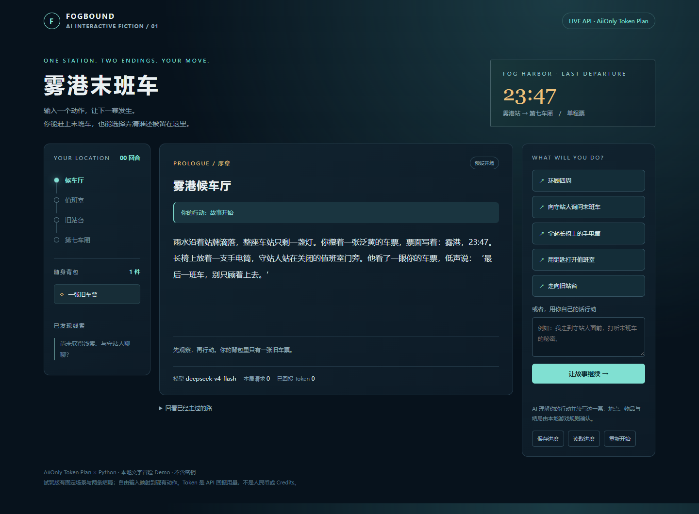

# 雾港末班车 / Fogbound — AI 文字冒险

> **输入一个动作，下一幕就会发生改变。** 玩家在雨夜车站寻找线索，最后做出选择。模型负责叙事，Python 管理可验证的游戏状态。



## 先体验

- **无需密钥：** 下载 [离线剧情回放](replay.html)，双击后可浏览真实模型生成的各幕与两种结局。回放不会发起 API 请求。
- **联网试玩：** 使用自己的 AiiOnly Token Plan 专用 Key，在本机启动 Python 服务；可以点动作按钮，也可以自己输入中文行动。
- **GitHub Pages：** 若 Pages 已启用，访问 https://lightrain-a.github.io/Fogbound-AI-Text-Adventure/ 查看静态回放（不是在线生成的新游戏）。

## 快速启动

环境：**Python 3.10+**；不需要额外 pip 安装、数据库、GPU 或 Docker。Windows 可双击 `START_GAME.bat`。

1. 在 [AiiOnly Token Plan](https://maas.aiionly.com/tokenPlan) 开通可用套餐，并在套餐相关的密钥管理入口获取 `tk-` Key。**普通 `sk-` Key 与套餐专用 Key 不能混用。**
2. 在本机设置环境变量 `AIONLY_TOKENPLAN_API_KEY`。勿将真正 Key 粘贴进仓库、网页或公开截图。
3. 在本目录运行：

```powershell
python app.py --open
```

然后打开 http://127.0.0.1:8765/ 。默认模型为 `deepseek-v4-flash`。也可尝试 `python app.py --model glm-5.2 --open`，但不同模型的能力与参数兼容性需要另行验证。

Windows 已授权电脑上的开发版支持读取上一级目录中仅当前用户可解密的 `.aiionly_tokenplan.dpapi`；该文件和任何真实密钥**都不在 GitHub 仓库中**。新电脑直接设置环境变量即可。

## 游戏怎么玩？

故事里有四个地点：候车厅、值班室、旧站台、第七车厢；还有旧车票、铜钥匙、手电筒和失踪者名单。

**建议第一局：** 向守站人询问 → 拿手电 → 打开值班室 → 找到名单 → 前往站台。此时可以选择出示名单，或独自登车，分别达到不同结局。

模型可以把“我想推开门”理解为一次开门尝试，但背包里没有钥匙时，门就不会打开。玩家直接宣告“我已经通关”，也不能更改存档。游戏并非无限生成地图或道具。

## 原理与源码

```text
玩家输入 → 识别意图（LLM）→ 验证行动（engine.py）
        → 确认新状态 → 生成叙事（LLM）→ 更新界面/存档
```

| 文件 | 功能 |
|---|---|
| `engine.py` | 地点、背包、规则与两种结局 |
| `llm.py` | AiiOnly API、流式 SSE、模型参数 |
| `game.py` | 事务式回合、保存和恢复 |
| `app.py` / `index.html` | localhost 页面与交互 |
| `test_game.py` | 28 项不收费的离线测试 |
| `browser_check.py` | Playwright 浏览器检查，需自行安装 Playwright |
| `evaluate.py` | 会产生真实模型调用费用的最小评估，不建议随意重跑 |
| `replay.html` | 本轮真实剧情的离线回放 |
| `screenshots/` | 实际桌面与移动端界面截图 |
| `evidence/` | 无密钥的用量和测试摘要 |

## 已验证的范围

- 2 轮真实游戏流程合计：**24 次 API 请求、14,587 Token**；修订后的那一轮：**12 次、6,599 Token**。
- 28 项离线单元测试、11 项浏览器基础检查通过；最小流程验证了两种结局、无钥匙开门失败、口头宣告通关无效以及存档恢复。
- API 返回的 Token 用量不是人民币金额，也不能当作后台 Credits 的同范围账单。
- 本项目仅支持本机单人试玩，不具备公网服务所需的账户鉴权与部署能力；勿直接改为监听 `0.0.0.0`。

## 来源与许可

参考了 [william-gaudelier/text-ai-rpg](https://github.com/william-gaudelier/text-ai-rpg) 的文字冒险和记忆组织思路。中文场景、规则、网页和 API 适配为本项目单独实现，并非对上游项目的逐行复现；详见 [来源说明](THIRD_PARTY_NOTICES.md)。

代码以 [MIT License](LICENSE) 发布。